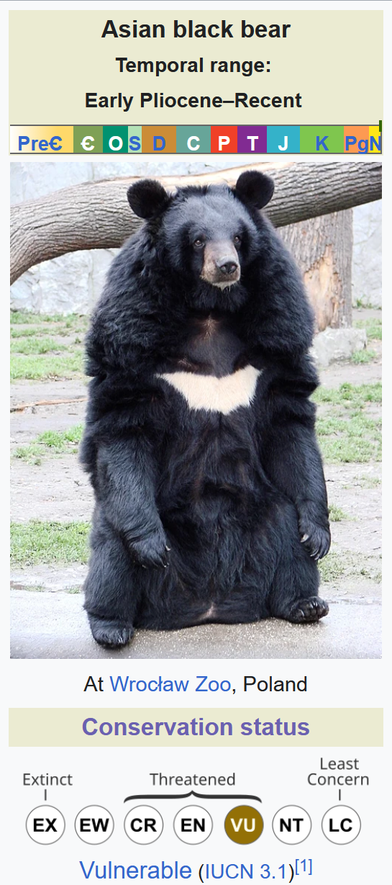

# Russia’s Biodiversity: IUCN Red List Overview

The following project explores IUCN Red List assessments published between 2020 and 2026 for species recorded in the Russian Federation, focusing on conservation status, population trends, threats, and recommended conservation actions. Here, we try to answer the folowing questions:

1. What is the current conservation status of the assessed species recorded in the Russian Federation?
2. How have conservation statuses and population trends changed over time?
3. What are the most common threats affecting the assessed species with declining populations, and which conservation actions can help most?

See screenshots [here](documentation/superset_assets/screenshots)

## Quick note on IUCN
The International Union for Conservation of Nature’s (IUCN) Red List of Threatened Species is the world’s most comprehensive information source on the global conservation status of animal, fungi and plant species. 

It divides species into nine categories: 

- Extinct (EX) – There are no known living individuals
- Extinct in the wild (EW) – Known only to survive in captivity, or as a naturalized population outside its historic range
- Critically Endangered (CR) – Highest risk of extinction in the wild
- Endangered (EN) – Higher risk of extinction in the wild
- Vulnerable (VU) – High risk of extinction in the wild
Near Threatened (NT) – Likely to become endangered in the near future
- Conservation Dependent (CD) – Low risk; is conserved to prevent being near threatened, certain events may lead it to being a higher risk level
- Least concern (LC) – Very low risk; does not qualify for a higher risk category and not likely to be threatened in the near future.
- Widespread and abundant taxa are included in this category.
- Data deficient (DD) – Not enough data to make an assessment of its risk of extinction
- Not evaluated (NE) – Has not yet been evaluated against the criteria.
 

*[Example](https://en.wikipedia.org/wiki/Asian_black_bear) of a species assessed by the IUCN and assigned a conservation status*

## Data
On September 29th 2026, the data encompassess 6,230 assessments published between year 2020 and 2026 on species recorded in Russia. The data was scraped from [IUCN Red List API v4](https://api.iucnredlist.org/).

## Skills and tools
This is a pet project developed to showcase full analytical workflow from API ingestion, orchestration, data modeling, quality checks, warehouse design, dashboarding, and interpretation.

Key skills and tools:

| Tool | Skill |
|------|-------|
| Apache Airflow | Data engineering and data quality monitoring |
| Clickhouse | Data warehouse architecture, data modeling, query optimization |
| Apache Superset| Business Intelligence and reporting |
| brain 🧠 | Analytics and insight delivery|

The project also involved docker, git, HTML and CSS.

## Insights
**Q1. What is the current conservation status of species recorded in the Russian Federation?**

Between 2020 and 2026, the IUCN published assessments for 5,526 species recorded in Russia. Among the latest assessments, Least Concern is by far the most common Red List category, accounting for 75% of assessed species. Population trends show a similar pattern: 39% of assessments report a stable population trend. Taken together, 38% of the latest assessments classify a species as Least Concern with a stable population trend, making this the largest combined group.

However, because assessment coverage is heavily biased toward animals, it is useful to consider the three kingdoms separately. The dominance of Least Concern persists across all groups and is especially pronounced among plants (90%) and fungi (80%). A stable population trend is also the most common trend within each kingdom.

Threatened species with declining populations represent 8% of assessed fungi, 7% of animals, and 2% of plants. However, it should be taken into account that the number of assessed fungi and plants is fairly low -- 213 and 320 respectively. 

In addition, 10% of species are classified as Data Deficient or Not Applicable, highlighting the limits of current assessment coverage.

**Q2. How have conservation statuses and population trends changed over time?**

The number of assessments carried out (not published!) each year has been uneven since 2018. The largest peaks occurred in 2020 (approximately 1,150 assessments) and 2023–2024 (approximately 3,740 assessments), while other years recorded fewer than 500 assessments.

In years with a high volume of assessments, the proportion of assessments resulting in a threatened category or a declining population trend tends to be lower. Conversely, the highest proportions of threatened statuses and declining trends occur in years with relatively few assessments. While there seems to be an inverse relationship between assessment volume and the share of “unfavourable” outcomes, this likely reflects differences in the species assessed rather than an actual improvement in conservation status.

**Q3. What are the most common threats affecting species with declining populations, and which conservation actions can help most?**

Among threatened animal species, the five most frequently recorded threats are agriculture and aquaculture, biological resource use, climate change and severe weather, pollution, and natural system modifications. Most of these threats are closely linked to human activity, unlike threats such as geological events or problematic species, genes, and diseases.

For conservation actions, habitat protection and awareness-raising are the most commonly recommended measures.

Fungi show a similar pattern: human activity is a major source of pressure, and habitat protection and restoration are the most frequently recommended responses.

Among the eight threatened plant species, threats also include problematic species, genes, and diseases. Recommended actions include habitat protection and restoration, harvest management, and control of problematic species.

**Conclusion**

IUCN assessment coverage for species recorded in Russia is dominated by animals, with comparatively limited coverage of plants and fungi. Across all three kingdoms, most assessed species are classified as Least Concern and have stable population trends, suggesting a relatively favourable conservation status among assessed species.

However, the annual distribution of assessments is highly uneven, with peaks in 2020 and 2023–2024. These peaks coincide with lower proportions of threatened species, which may reflect differences in the species assessed rather than genuine changes in extinction risk.

Among threatened species, human-related threats are the most common, and **habitat protection** appears to be the most broadly recommended conservation action. While it may not eliminate all risks, habitat protection is likely to be one of the most effective measures to help prevent further decline of the assessed species.

## Project structure

The project consists of three main components:

- [ETL pipeline in Airflow](link)
- [Data warehouse in ClickHouse](link)
- [Interactive dashboard in Apache Superset](link)

For more detailed information about each component, see the corresponding documentation.

## Limitations

- The analysis covers only seven years of IUCN assessments due to resource constraints, while the IUCN Red List contains data spanning a much longer period.
- IUCN assessment coverage is not random. The results should therefore not be interpreted as a representative measure of the overall conservation status of species in the region.
- A more comprehensive analysis would benefit from additional data on [IUCN Green Status](https://www.iucnredlist.org/about/green-status-species).

## Backlog

The project could be further developed in several areas, including data exploration, visualization, and architecture:

- Add full-text analysis of threats, trade and use, and conservation actions.
- Add information on transitions between Red List categories (requires additional data).
- Add more detailed geographic range information.
- Extend the time range of assessments.
- Explore threat scope, severity, and timing.
- Identify and handle corrected assessments.
- Update the latest-assessment flag when new assessments are added.
- Add additional data-quality checks.

# Sources
- IUCN 2026. IUCN Red List of Threatened Species. Version 2026-1 <www.iucnredlist.org> 
https://www.iucnredlist.org/assessment/supporting-information
https://gist.github.com/rxaviers/7360908
- Clickhouse documentation pages on query optimization: https://clickhouse.com/docs/guides/clickhouse/performance-and-monitoring/query-optimization
