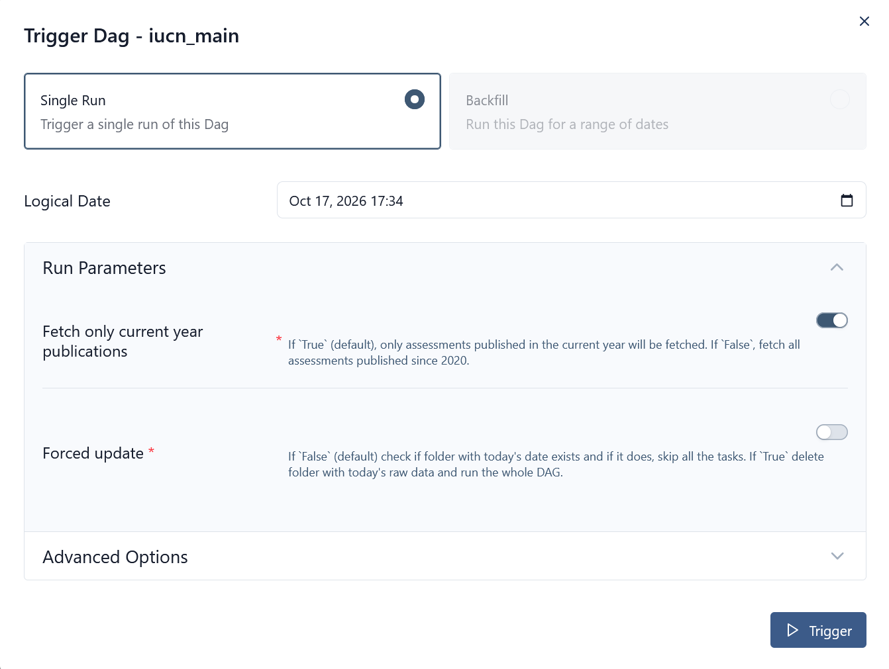

# ETL-pipeline. Airflow

The ETL pipeline extracts raw data, stores it locally for transparency and data lineage, transforms and loads it into the data warehouse, and creates data marts for reporting.

Data-quality checks run after each stage—extraction, transformation, and loading—to validate the resulting data (see [Data quality checks](#data-quality-checks)).

<i>ETL pipeline implemented in Airflow</i>

Orchestration is implemented through three DAGs:

- Main DAG — contains the core pipeline logic and triggers the other DAGs.
- Reference-table update DAGs — update reference tables.
- Data mart update DAG — updates data marts.

Because the IUCN Red List is updated only a few times a year ([source](https://www.iucnredlist.org/assessment/updates)), checking for new assessments daily would be unnecessary and wasteful -- especially since the API cannot be queried with granularity finer than a year. For this reason, the main DAG is configured to run manually rather than on a schedule.

<i>ETL pipeline implemented in Airflow</i>

## Main DAG (`iucn_main`)
DAG where the core pipeline logic is implemented.

### Steps
1. Check if today's progress already loaded. If true and parameter `forced` (see screenshot below) is false or the dag has not ran today, skip the rest of the steps.
2. Create table for data checks if it does not exist.
3. Update (replace) reference tables by calling a separate DAG.
4. Call API to fetch a list of assessments of species inhabiting Russia published in current year if parameter `current_year_only` (see screenshot below) is True, otherwise extract lists of all assessments since 2020. This step results in a collection of JSON files stored in `DATA_RAW_COUNTRIES` (local storage).
5. Call API to fetch detailed data on each assessment that does not exist in the database. The step results in a collection of JSON files stored in `DATA_RAW_ASSESSMENTS` (local storage).
6. If no new assessments found, skip the rest of the DAG.
7. Parse JSONs obtained in Step 5, split into multiple tables, save locally.
8. Load the normalized data to Clickhouse (schema `detail`).
9. Update datamarts.

If at any point an exception occurs, the whole DAG is marked is Failed.

## Reference-table update DAGs (`iucn_load_*`)
Reference tables act as dictionaries of categorical values, their codes and suppementary information added during the tranformation stage of each DAG. Updates of reference tables are organized into separate multi-task DAGs:

|DAG id|Description|
|------|-----------|
|`iucn_load_red_list_categories_mapping`|Extracts a list of Red List categories, applies mapping to add ordering number in front of each category of version 3.1, load data to table `dict.red_list_categories_mapping` with replacement.|
|`iucn_load_habitat_system_mapping`|Extracts a list of habitats, splits multi-level habitats into separate levels, applies mapping to add a system to each habitat, load data to table `dict.habitat_system_mapping` with replacement.|
|`iucn_load_threats__dict`|Extracts a list of threats, splits multi-level threats into separate levels, load data to table `dict.threats__dict` with replacement.|
|`iucn_load_stresses__dict`|Extracts a list of stresses, splits multi-level stresses into separate levels, load data to table `dict.stresses__dict` with replacement.|

Data quality checks run after the transform and load stages.

## Data mart update DAG (`iucn_update__datamarts`)
Datamarts in this project are designed to each be used by a specific dashboard tab. The datamarts are formed and updated with SQL scripts, where a table is created if it does not already exist, truncated and data is inserted.

Data quality checks run after the load stage.

## Data quality checks

Structural checks are embedded in the pipeline tasks because further validation is impossible if no data is returned or the structure is invalid.

The pipeline performs the following data-quality checks:

- Row-count validation
- Primary- and compound-key uniqueness (using pandas DataFrame method `.duplicated`)
- Completeness (using pandas Series method `.isna().sum()`)
- Expected-value validation/unexpected-value detection

All checks are implemented in the `dataQualityReport` class and can run against a pandas DataFrame, a local file, or a database table.

Each check returns one of the following statuses: `ok`, `failed`, `unsupported` (when called data check does not exist), or `error` (raised during execution). Results may also include a comment and are loaded into the `data_quality.main` table.