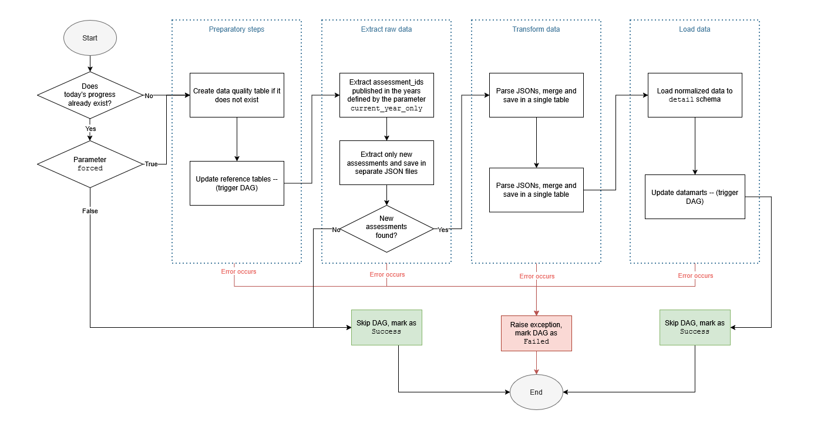
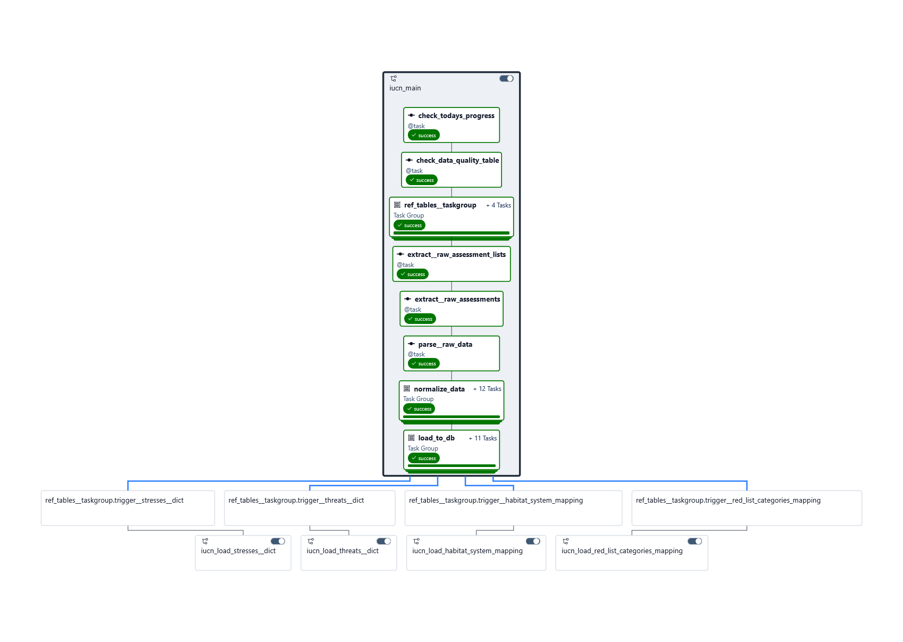

# ETL-pipeline. Airflow

The aim of the ETL pipelins is to extract raw data, save locally for transparency and data lineage, transform and load data to data warehouse, and form datamarts for reporting. After each step -- extract, transform or load, data quality checks are ran on the resulting data (see [Data quality checks](#data-quality-checks)). 

ETL pipeline is implemented in Apache Airflow and can be described by the following diagram:

<i>ETL pipeline implemented in Airflow</i>

Orchestration is realized through three DAGs:
- main DAG where the key logic is realized and whicj triggers the other DAGs
- DAG for updating reference tables
- DAG for updating datamarts.

Since IUCN Red List updates only a few times a year ([source](https://www.iucnredlist.org/assessment/updates)), there is no need (and frankly it is wasteful) to check for new assessments every day, especially when there is no way of limiting API queries with granularity smaller than year. That is why the main DAG is configured to be ran manually and not on schedule.

<i>ETL pipeline implemented in Airflow</i>

## Data quality checks

Structural checks are integrated in the tasks because if there is no data or the structure is invalid, we won't be able to run any other checks. 

Data checks include:
- number of rows
- uniqueness (primary key or compound key)
- completeness
- whether column contains unexpected values expected values.
All the checks are defined in class `dataQualityReport`.

Data checks can be ran on a pandas DataFrame, data stored in a file or a table in the database.
As a result checj outputs one of the following statuses:
- `ok`
- `failed`
- `unsupported`
- `error` (during execution)
in some cases with a comment. The result is loaded to the database table `data_quality.main`
