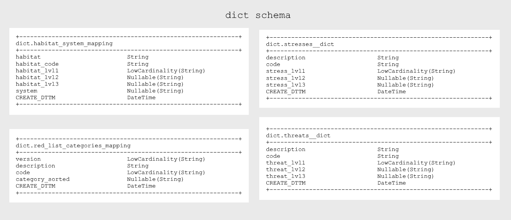
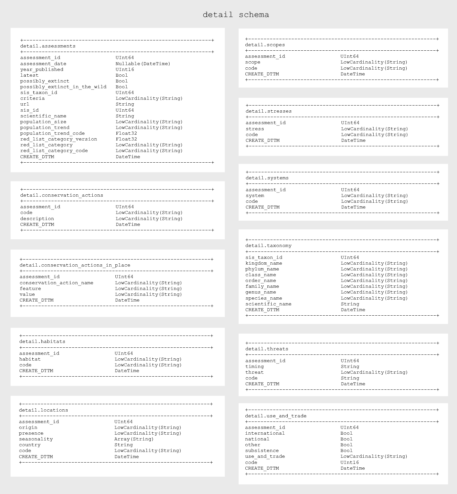
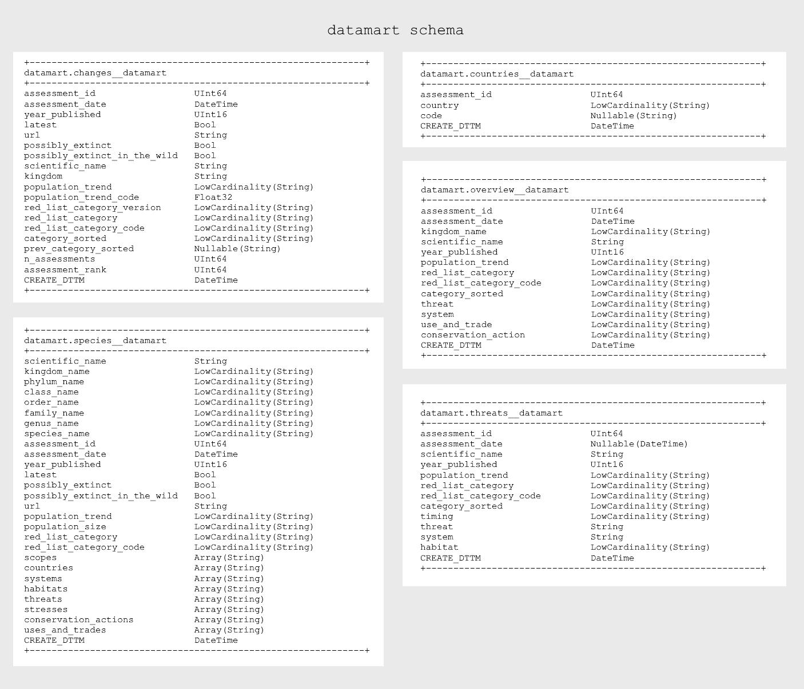
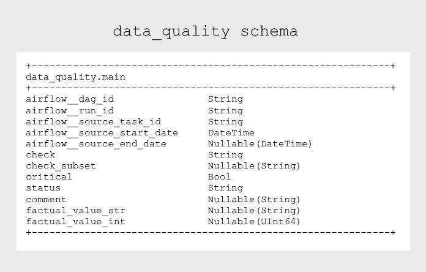

# Clickhouse
## Database structure

The ClickHouse database is organized into four schemas:
- `dict`
- `detail`
- `datamart`
- `data_quality`

For performance optimization, appropriate **data types** were selected, **nullable** columns were avoided, and **indexes** were created.

### `dict` schema
Schema contains reference tables.

Reference tables act as dictionaries of categorical values, their codes and suppementary information added during the tranformation stage.

### `detail` schema
Schema contains tables for core entities such as assessments, threats, habitats, and conservation actions. The raw data retrieved from the IUCN API is stored in nested JSON files; flattening it would produce a large, highly denormalized table. To reduce storage overhead and improve data transparency, the ETL pipeline normalizes this data into separate tables.

### `datamart` schema
Schema contains tables used for reporting. Each dashboard tab has a dedicated table (see the [dashboard documentation](superset_readme.md)).

### `data_quality` schema
Schema contains a single table, `main`, which stores the results of data-quality checks (see the [ETL pipeline documentation](airflow_readme.md#data-quality-checks)).

