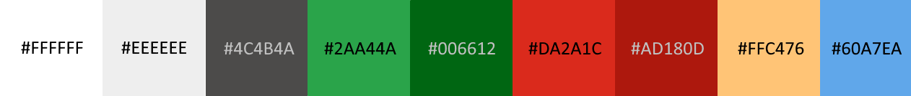

# Notes on dashboard implementation
## Key features
- Jinja templates
- CSS styling
- Color coding with advanced configurations
- Cross-filtering
- Clickable links

## Styling and color coding

The dashboard uses a color scheme inspired by the IUCN Red List website.

<i>Colors used on the dashboard</i>

Several charts use color coding to make interpretation easier:

- Values with positive implications, such as an Increasing population trend, are shown in green.
- Values with negative implications, such as a Decreasing population trend, are shown in red.
- Values that signal caution, such as the Near Threatened Red List category, are shown in yellow.
- Values with neutral implications, such as a Stable population trend, are shown in blue.
- Values with unknown implications, such as an Unknown population trend, are shown in grey.

Tables also use colored emojis as additional visual cues.

Color coding is implemented through both the **CSS styling** and **advanced configuration** sections of the dashboard properties.

## Tabs breakdown

The dashboard consists of four tabs, each focused on a different topic.

### Overview

This tab helps to understand the volume of the data collected, how the data is distributed and the **peculiarities that should be considered during analysis**. 

> For example, the tab shows inconsistent number of assessments published over the years, as well as a heavy bias towards animals.

A high-level summary of the dashboard data is delivered by the following:

- Total number of latest assessments and species
- Publication time span
- Geographic coverage
- Distribution of Red List categories and population trends
- Most common threats, uses and trades, and conservation actions

Although the dashboard focuses on species recorded in Russia, geographic range information still provides useful context.

The data can be filtered by conservation status, and the underlying dataset is structured to support dynamic **cross-filtering**.

<i>Tab "Overview"</i>

### Change over time

This tab explores **how assessments have changed over time**, covering conservation statuses and assessment volume by both publication year and assessment finalization year.

Because coverage is heavily skewed across taxonomic groups, users can filter by kingdom: animals, fungi, or plants.

Two sub-tabs are available at the top:

- *Assessment volume* shows the uneven annual distribution of assessments and the delay between assessment finalization and publication, both of which complicate trend interpretation.

- *Changes in statuses* displays the relative share of each conservation status by assessment year.

The bottom table lists the species with the oldest latest assessments—those that have not been reassessed for the longest time. It includes the species name, assessment date, time since assessment, conservation status, and a **clickable link** to the assessment.

<i>Tab "Change over time". Assessment volume is active</i>

<i>Tab "Change over time". Changes in statuses is active</i>

### Habitats and threats

This tab shows the most common threats recorded for assessed species - threatened species (Red List category is `Vulnerable`, `Endangered` or `Critically Endangered`) with a `Declining` population trend by default - broken down by system and habitat. This information helps us understand what threats should be targeted first in order to help prevent further decline of the assessed species that are already or close to being endadgered. 

Filters are available for conservation status, including Red List category and population trend.

The pivot table at the bottom shows, for each habitat, the percentage of assessments that also mention each threat. The table can be sorted, allowing users to compare threats within a specific habitat.

**Important notes**

1. IUCN assessments do not establish a direct relationship between individual threats and habitats.
2. This tab includes only the latest assessment for each species.

<i>Tab "Threats and habitats"</i>

### Species explorer

This tab contains a single table that displays all assessments matching the selected filters. Users can filter assessments by taxa, conservation status, assessment metadata, threats, and habitats.

The table includes columns for all filterable fields, as well as a **clickable link** to the corresponding assessment on the IUCN website.

Several filters have default values:

- **Red List category:** `Vulnerable`, `Endangered`, and `Critically Endangered`
- **Population trend:** `Decreasing`
- **Latest:** `True`

Habitats, threats, systems, conservation actions, and uses and trades are stored as arrays in the data mart. **Jinja templates** are used for filtering so that users can filter by an individual value within an array rather than having to match the entire array.

<i>Tab "Species explorer"</i>
